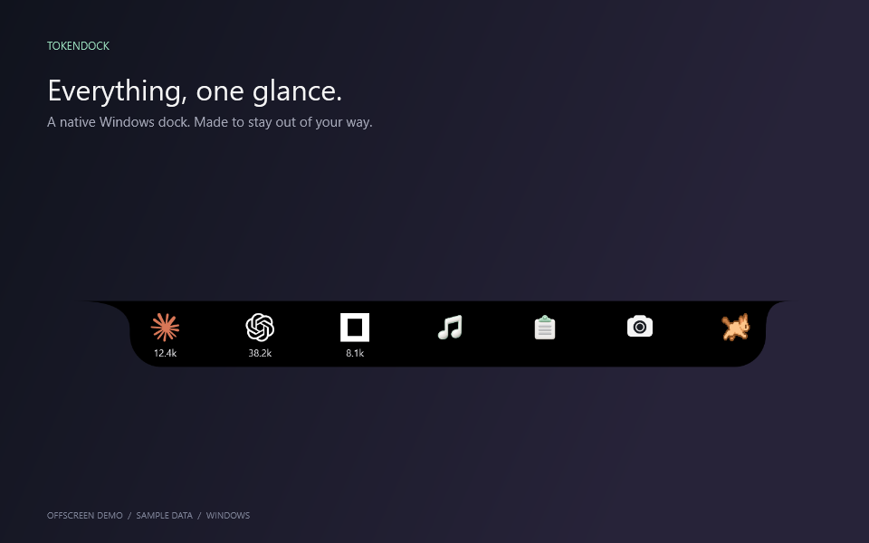
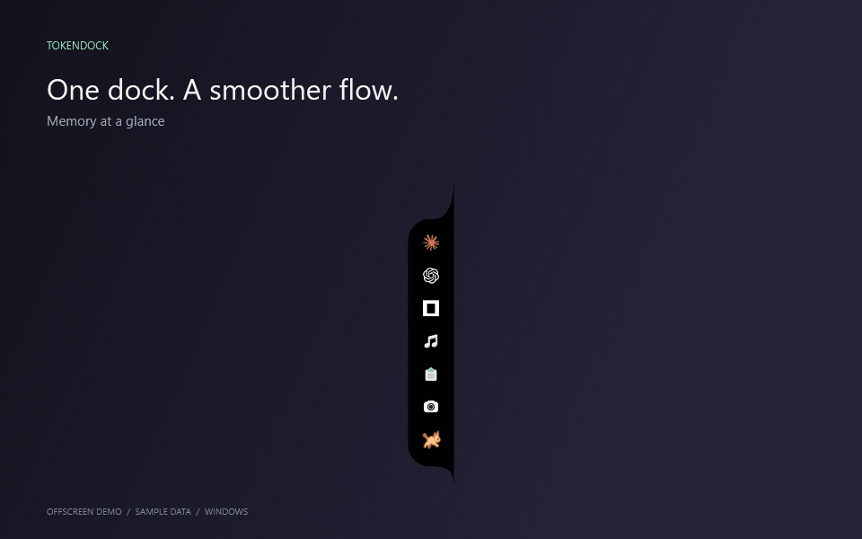
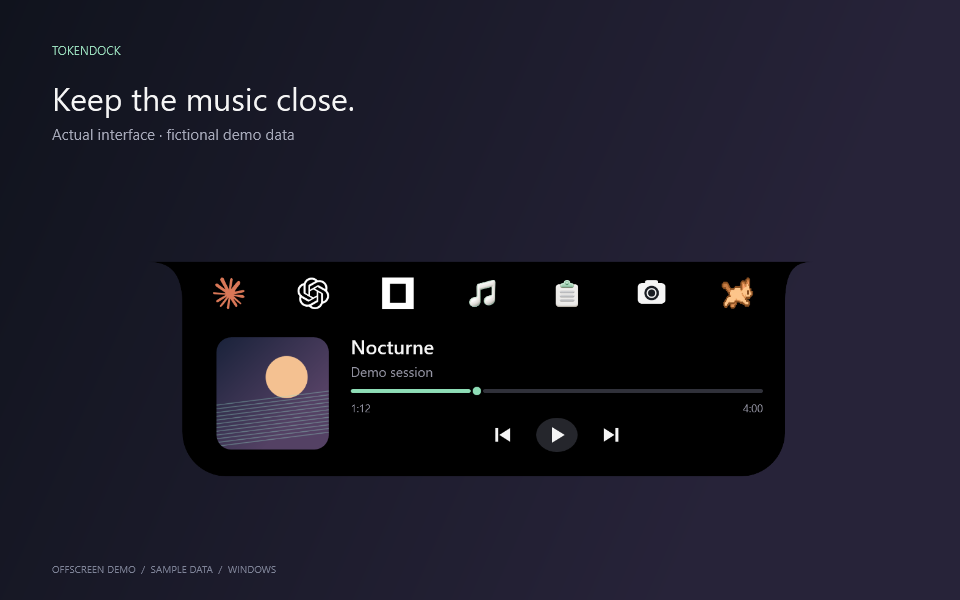
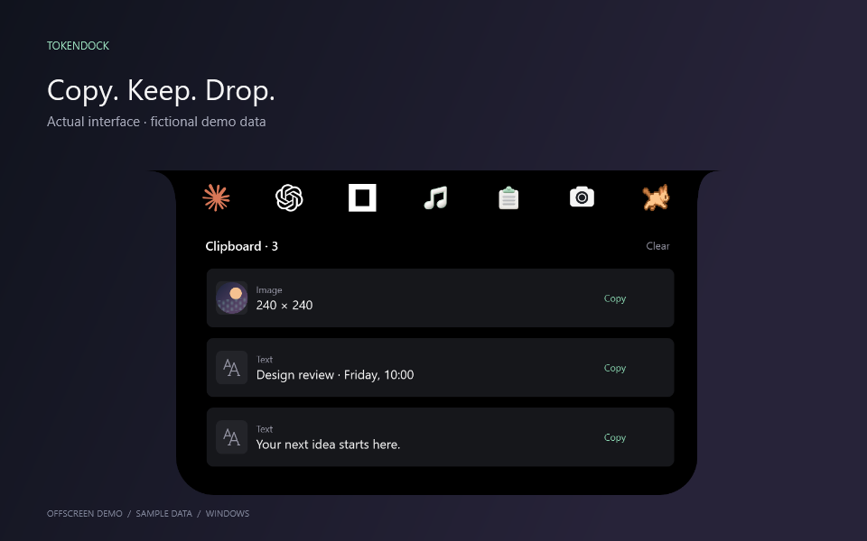
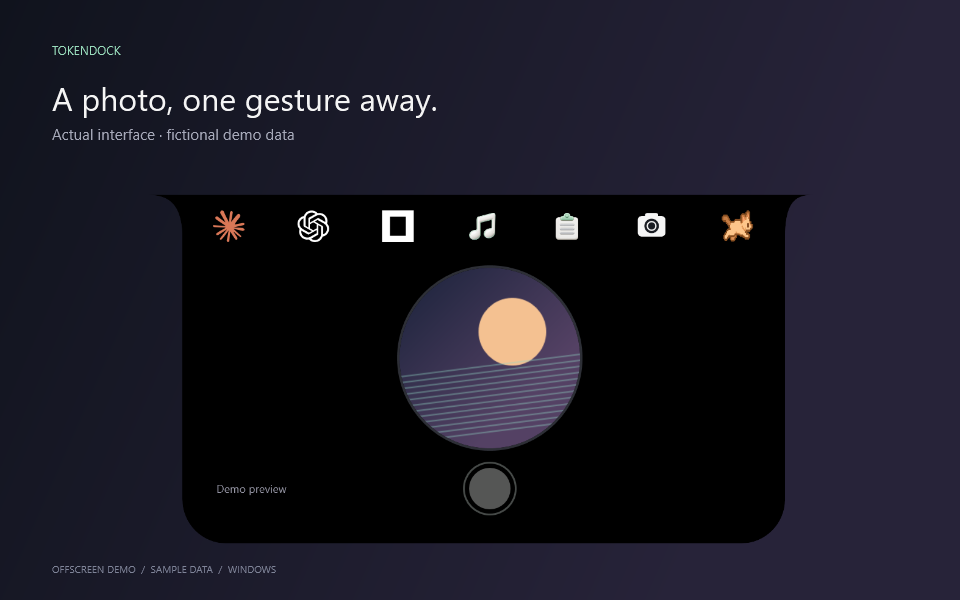
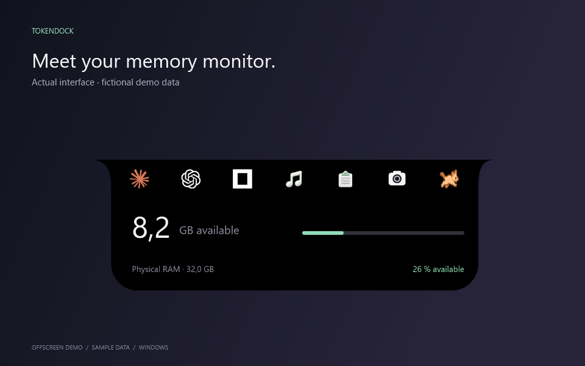
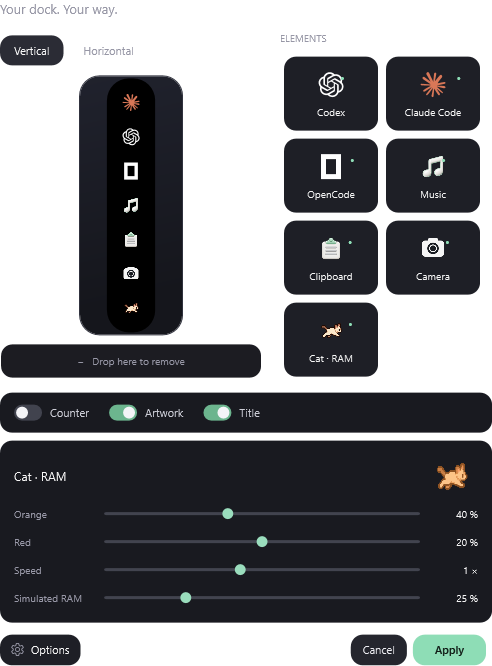

<div align="center">

# TokenDock

**Your AI usage, music, clipboard, camera and memory. One small Windows dock.**

[Download](https://github.com/Lockxii/TokenDock/releases/latest) · [AI customization guide](docs/AI_GUIDE.md) · [Report a bug](https://github.com/Lockxii/TokenDock/issues)




</div>

A native **C# / WPF / .NET 10** desktop app with no embedded browser. Dock it to any screen edge or leave it floating. Hover to expand, drag to reorder, and keep the things you use close.

## See it in motion



*Actual Windows components, fictional data. The GIF illustrates opening and module changes with scripted timing, not a desktop recording or performance benchmark. No private camera, clipboard or session data was used.*

<table>
<tr><td><b>Music, within reach.</b><br>Playback without another window.</td><td><b>Copy. Keep. Drop.</b><br>Files and ideas, ready to use.</td></tr>
<tr><td><b>One photo. Straight to Clipboard.</b><br>A round PNG you can drag elsewhere.</td><td><b>A cat with a purpose.</b><br>Memory pressure at a glance.</td></tr>
</table>

## Platform status

| Platform | Status |
| --- | --- |
| Windows 10 2004+ / Windows 11, x64 | Available; self-contained download |
| Linux | Not available; full feature parity required before release |
| macOS | Not available; full feature parity required before release |

**The released app is Windows-only.** A real Avalonia desktop port now exists in [desktop/](desktop/README.md), including inline music, Clipboard and native camera adapters. It is under development and has not passed the full [Linux/macOS release gate](docs/PLATFORMS.md). No Linux/macOS release binaries are available yet.

## Contents

- [Installation](#installation)
- [Quick start](#quick-start)
- [Modules](#modules)
- [Customization](#customization)
- [Privacy and local data](#privacy-and-local-data)
- [Build and test](#build-and-test)
- [Modify with an AI assistant](#modify-with-an-ai-assistant)
- [Troubleshooting](#troubleshooting)
- [Architecture](#architecture)
- [Contributing and license](#contributing-and-license)

## Installation

### Download and run

1. Open the [latest release](https://github.com/Lockxii/TokenDock/releases/latest).
2. Download its **Windows x64 ZIP** and optionally `SHA256SUMS.txt`.
3. **Extract the entire archive** into a writable folder, such as `Documents\Applications\TokenDock`.
4. Run **`TokenDock.Next.exe`** from the extracted folder.

The ZIP includes .NET. No separate runtime, account, API key or subscription is required. Keep the executable, DLLs and `assets/` together; do not run from inside the ZIP.

Requirements: Windows 10 version 2004 or later, or Windows 11, on x64. Camera needs a webcam; music needs a player exposing a Windows media session. The executable is unsigned: verify its origin/checksum before deciding to accept a Windows reputation warning. Do not disable security globally. Run normally, **not as administrator**.

Verify a download, substituting its actual filename:

```powershell
Get-FileHash .\TokenDock-v0.2.0-win-x64.zip -Algorithm SHA256
```

Compare the hash with `SHA256SUMS.txt`.

### Update or uninstall

Quit the previous instance using the dock menu or tray icon. Extract the new version into a new folder and launch it. Settings remain in `%LOCALAPPDATA%\TokenDock`. Only one instance runs at a time; a new executable does not replace one already running.

To uninstall, quit and delete the app folder. To reset settings, back up anything needed and remove `%LOCALAPPDATA%\TokenDock`. Photos in `Pictures\TokenDock` remain until removed separately. No service or startup entry is installed.

## Quick start

| Gesture | Action |
| --- | --- |
| Hover an icon | Open its panel after 60 ms |
| Click a module | Keep its panel open |
| Right-click | Position, customize, hide, reset tokens or quit |
| Drag an icon | Reorder it directly |
| Drag empty dock space | Move the entire dock, including free placement |
| Escape | Cancel icon drag or close the panel |
| F1 with dock focus | Expand/collapse; not a global shortcut |
| Double-click tray icon | Restore a hidden dock; check hidden notification icons |

Interrupted animations preserve their motion. Windows' reduced-animation preference is respected.

## Modules

### AI token usage

Built-in **Codex, Claude Code and OpenCode** readers, plus up to three custom JSON sources.

| Tool | Local source |
| --- | --- |
| Codex | `%USERPROFILE%\.codex\sessions`; respects `CODEX_HOME` |
| Claude Code | `%USERPROFILE%\.claude\projects`; respects `CLAUDE_CONFIG_DIR` |
| OpenCode | `%USERPROFILE%\.local\share\opencode\opencode.db`; respects `XDG_DATA_HOME` |

Codex/Claude use JSONL; OpenCode uses **read-only SQLite**, checked about once per second. Formats may change independently.

- Input, output and cache readings where available, plus graph hover details.
- Combined totals for visible tools, or details for a selected provider.
- Reset changes TokenDock's counters, never source files.
- New events are followed; full account history before launch is not reconstructed.
- These are local readings, **not billing, quotas or account-wide totals**.
- Not guaranteed token-by-token streaming: if a tool reports usage only after a response, intermediate values are unavailable.

### Music

Artwork/title when collapsed; playback, previous/next and seeking when expanded. Windows chooses the active session. Features depend on what the player exposes; missing duration or artwork is possible.

### Clipboard and temporary files

Enable Clipboard in Customize for **local, in-memory history**, limited to 20 cards. It starts after activation without importing old clipboard content.

- Click to copy; a checkmark confirms success.
- Drop regular files onto the dock for independent temporary copies.
- Drag file cards into Explorer or an app accepting files.
- Hover/focus a card to reveal its removal cross.
- Clear removes cards. Temporary files remain until normal exit to preserve in-progress transfers.

Limits: 100 files per drop, 256 MB temporary storage per session, no directories/reparse points. Text: 32,768 characters; images: roughly 4 million pixels; retained payloads: 32 MiB. Originals are never moved/deleted. History resets on restart; crashes may leave files under `%TEMP%\TokenDock-shelf`.

### Camera and photos

Add Camera and apply. The default color camera runs **only while its panel is open and visible**. Collapsing, hiding, switching modules or quitting releases capture. No microphone, video recording or upload.

The preview requests at most 640 pixels wide with the source ratio, updating around 15 frames/s. The shutter saves a **circular transparent PNG** with the preview's crop in the system Pictures folder under `TokenDock`.

**Clipboard opens automatically with the photo first**, pinned open for copying/dragging. Camera makes Clipboard accessible without enabling background clipboard history. Removing a card does not delete the saved photo. Some destinations flatten pasted bitmaps; dragging the PNG preserves its alpha channel.

### Cat and RAM

The cat represents **available physical RAM**, not only unused pages. It runs faster as availability falls. Customize orange/red thresholds and speed (0.25×–2×), with a simulated-RAM preview that does not change real memory. The panel shows major memory consumers where process data is accessible.

## Customization

Open **right-click → Customize**.



Drag elements in/out of the preview and freely mix tools/modules. Preview orientation helps composition; screen position comes from the dock menu. Configure counter, artwork, compact title and cat behavior. **Apply** saves; **Cancel** discards the draft. Direct dock reordering saves immediately. Clipboard remains accessible with Camera enabled.

### Custom JSON source

Options → source name → **Connect** → local JSON file:

```json
{"input":120,"output":45,"cache":0}
```

These are cumulative counters supplied by your integration. A name alone does not connect a tool. Publish real usage with a script, preferably by atomic replacement to avoid partial reads. See [the example](custom-usage.example.json) and `CustomFeeds` in [Personalization.cs](next/Personalization.cs).

## Privacy and local data

| Data | Location / handling |
| --- | --- |
| Settings/position | `%LOCALAPPDATA%\TokenDock` |
| Counters/history | App memory, no cloud sync |
| Dropped copies | `%TEMP%\TokenDock-shelf` |
| Captured photos | System Pictures folder, `TokenDock` subfolder |
| AI logs | Read locally; never uploaded by TokenDock |

No app telemetry, server account or embedded API key. Windows clipboard exclusion markers are respected when supplied. History may contain sensitive content: enable only if wanted. External tools/players have their own privacy policies.

No real photos, conversations, preferences or OpenCode databases are distributed. Documentation uses fictional data. Tests do not activate the camera or touch the real clipboard.

## Build and test

Install Git and the **.NET 10 SDK on Windows** from [Microsoft](https://dotnet.microsoft.com/download/dotnet/10.0). ZIP users do not need the SDK.

```powershell
git clone https://github.com/Lockxii/TokenDock.git
cd TokenDock
dotnet restore next/TokenDock.Next.csproj
dotnet publish next/TokenDock.Next.csproj -c Release -o artifacts/dev --no-self-contained
dotnet artifacts/dev/TokenDock.Next.dll --check
```

Inspect `artifacts/dev/checks.txt` and the PNGs. There are **2,130 offscreen checks**; the count may evolve. They validate calculations/rendering, not every hardware device or desktop gesture. Some inspect system memory metrics.

Launch manually after quitting another instance:

```powershell
.\artifacts\dev\TokenDock.Next.exe
```

Build an autonomous ZIP with runtime, notices and checksum:

```powershell
.\scripts\package.ps1 -Version 0.2.0
```

The script tests then packages a runtime allowlist, excluding generated test files. Windows CI runs on pushes and pull requests.

Reproduce documentation media without controlling the desktop:

```powershell
.\scripts\render-media.ps1
```

FFmpeg in PATH is required for the GIF. `--demo` renders fictional data without opening a window or activating devices. Timing is illustrative, not a frame-rate benchmark.

## Modify with an AI assistant

Read [the complete guide](docs/AI_GUIDE.md) for Codex, Claude Code, OpenCode or another assistant. No assistant-specific plugin/key is required by this repo.

> Read AGENTS.md and relevant source. Add a 30–300 ms hover-delay setting, default 60 ms. Preserve debounce, interrupted motion and settings. Work on a branch. Build and run offscreen checks. Do not control my desktop, start my camera or read my clipboard. Do not publish unless requested. Summarize the diff, validation and limitations.

Do not share private logs, photos, clipboard, credentials or personal configuration. Source and synthetic fixtures suffice for most changes.

## Troubleshooting

| Symptom | Check |
| --- | --- |
| Nothing opens | Quit the previous instance and keep runtime files together. |
| Hidden dock | Double-click its tray icon, including hidden icons. |
| Zero tokens | Check paths/status and new usage events; missing data is not confirmed zero. |
| Camera unavailable | Windows privacy settings → Camera → allow desktop apps; check other camera users, then reopen. |
| No music | Start a player exposing a Windows media session. |
| Drop rejected | Regular files within limits; Clipboard enabled; app and Explorer at equal privilege. |
| Transparency lost | Drag the PNG; some apps flatten clipboard images. |
| Settings fail | Check access to `%LOCALAPPDATA%\TokenDock`. |
| No animation | Check Windows accessibility settings. |
| Scaling/layout issue | Report edge, DPI and monitor arrangement. |

Include version, OS, scaling, steps and expected/actual behavior in issues. Redact faces, filenames and private content. Never upload full AI conversations.

## Architecture

| Source | Responsibility |
| --- | --- |
| `next/App.cs` | Window, hover, tray, module composition and entry points |
| `next/NotchSurface.cs` | Rendering, geometry, hit tests, transitions, RAM/tokens |
| `next/SpringAnimation.cs` | Damped motion and retargeting |
| `next/Personalization.cs` | Preferences, order and JSON feeds |
| `next/PersonalizationView.cs`, `CatSettings.cs` | Editor and RAM preview |
| `next/IconGesture.cs` | Direct reordering |
| `Meter.cs`, `MemoryInfo.cs` | Usage and RAM readers |
| `next/MusicModule.cs`, `MusicPane.cs` | Media sessions/player |
| `next/ClipboardModule.cs`, `CopyItem.cs`, `FileShelf.cs` | History and temporary files |
| `next/InlineModules.cs` | Clipboard cards and music host |
| `next/CameraPane.cs` | Capture lifecycle and circular photo |
| `next/*Checks.cs` | Offscreen checks |
| `next/MediaDemo.cs` | Reproducible documentation renders |
| `assets/` | Logos, sprite and icons |

## Contributing and license

Read [CONTRIBUTING.md](CONTRIBUTING.md) and [AGENTS.md](AGENTS.md). Bounded work and native APIs help keep the dock lean, but **no universal CPU/RAM usage is guaranteed**.

[MIT license](LICENSE); [third-party notices](THIRD_PARTY_NOTICES.md). Independent of OpenAI, Anthropic, OpenCode and boring.notch.
